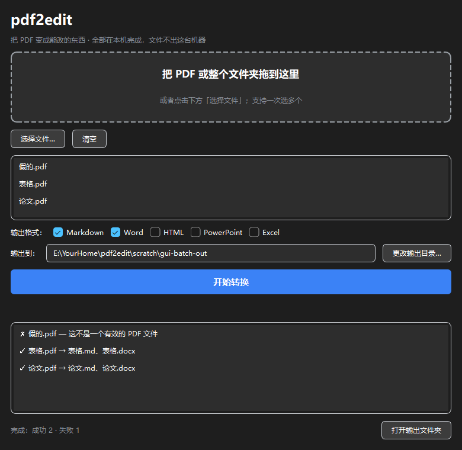
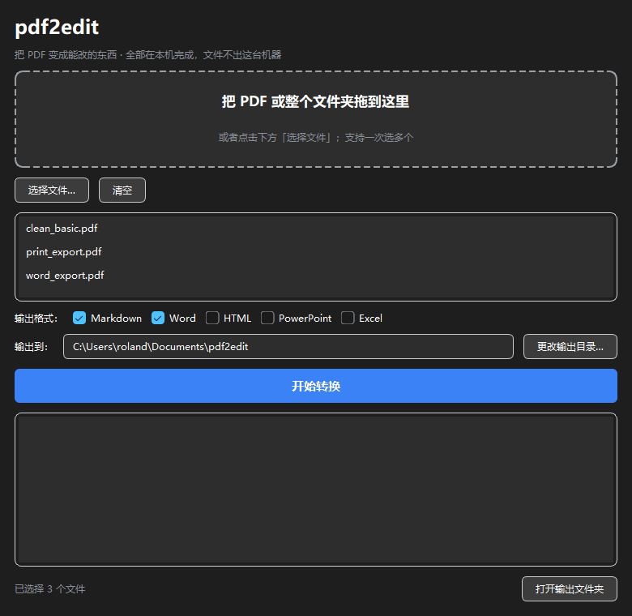

# pdf2edit

把来源正规的电子版 PDF，转成**可编辑的活内容**。本地、离线、开源。

不做扫描件，不做"看起来一样"，只做"**真的能改**"。

## 支持

| 输出 | 状态 | 说明 |
|---|---|---|
| Markdown | ✅ 可用 | 结构优先，适合喂给 AI |
| Word (docx) | ✅ 可用 | 流式，全部用 Word 内置样式（改一次样式全篇生效） |
| HTML | ✅ 可用 | 语义标签 + 干净 CSS，自带深色模式 |
| PowerPoint (pptx) | ✅ 可用 | 按原版面摆文本框，原生可编辑 |
| Excel (xlsx) | ✅ 可用 | 只输出识别到的表格，数字是真数字（可直接求和） |

## 不支持

- 扫描件、照片拍的 PDF
- 伪电子版（扫描图 + 坏 OCR 文本层）
- 图片输出（截图就能做）
- 保版式（绝对定位文本框，等于把截图装进 Word）

## 用法

```bash
python -m pdf2edit 输入.pdf                 # 默认输出 Markdown
python -m pdf2edit 输入.pdf --to docx -o 输出.docx
python -m pdf2edit --window                 # 桌面窗口
python -m pdf2edit --ui                     # 本地网页（127.0.0.1）
python tools/probe_pdf.py 输入.pdf          # 先体检，看这份能不能转
```

## 批量

窗口里可以一次拖进多个 PDF，也可以**直接拖一个文件夹**：

```bash
python -m pdf2edit 一堆论文/ --to md docx -o 输出目录
```

- 文件夹只扫**当前一层**，不进子文件夹（免得手滑拖了整个盘就把整个盘转了）
- 每份独立转换，一份失败不影响其他，最后给出「成功 / 部分跳过 / 失败」的汇总
- 只勾一种格式：平铺输出 `a.md`、`b.md`
- 勾了多种格式：每份一个子文件夹 `a/a.md`、`a/a.docx`（否则 3 份 × 5 格式就是 15 个文件摊一地）
- 不同目录里的同名文件自动写成 `report (2).md`，不会互相覆盖

批量跑完是这样（三份里有一份不是 PDF，会单独标出来，不耽误其他）：



桌面窗口长这样：



两种界面共用同一条转换流水线（`src/pdf2edit/convert.py`）。拖入 PDF、勾格式、点一下，结果落在输出目录。全部在本机完成，不联网。

文字层不可信的文件会被明确拒绝并说明原因，不会硬转出乱码。

## 双击就能用（打包版）

```bash
powershell -File tools/build_exe.ps1     # 构建单文件 exe（约 89 MB）
```

产物在 `dist\pdf2edit.exe`：双击打开，不需要装 Python，也不需要命令行。构建脚本最后会拿真实样本跑一遍自检，确认打进去的依赖都可用。

打包版和命令行是同一份代码，界面里拖入 PDF、勾格式、点「开始转换」即可。

## 目录

```
docs/specs/     设计文档
src/            源码
tests/          测试
fixtures/       测试样本（含真实来源：Word 导出、浏览器打印）
tools/          辅助脚本
```

## 开发

```bash
python -m pip install pymupdf fonttools python-docx python-pptx openpyxl flask pyside6 pytest
python -m pytest tests -q
```

## 验证过什么

- 合成样本：标题 / 段落 / 列表 / 页码
- 浏览器打印（Edge headless）：无符号列表、表格
- Word 导出：H1/H2 只差 1pt、项目符号独立成段、表格基线差 2.5pt
- 往返闭环：PDF → docx → Word 导回 PDF → 再转 Markdown，结构一致

## 已知限制

这些会导致输出不完整，用之前请先确认你的文档不在其中：

- **图片一律丢失**——目前不处理图片
- **跨栏图表、通栏插图的图注** 可能被归错栏
- **公式** 不转 LaTeX，会变成普通文本或丢失
- **页眉页脚** 靠"页边带 + 小字号"识别，字号不小或不在页边的会漏
- **多栏页里再嵌表格** 当前不支持（含表格的页不切栏）
- **单元格内换行的表格会散架**——按文字基线聚类，一个格子里的两行会被当成两行表格（输出里会留 ⚠️ 标记）
- **合并单元格不支持**——表头跨列时，合并的那格会被排除在表格外
- **旋转 90° 的文字** 能提取，但位置和顺序可能错乱（会被排到正文之前）
- **批量的文件夹只扫一层**，子文件夹里的 PDF 不会被转
- 三栏以上排版未充分验证

## 许可证

AGPL-3.0，全文见 [LICENSE](LICENSE)。选它是因为依赖 PyMuPDF，而 PyMuPDF 本身是 AGPL。

说人话：**自己用、公司内部用、随便改，都不用付钱，也不用告诉我们。**约束的是「把它做成在线服务对外提供」——那种情况得把改动一起开源。
